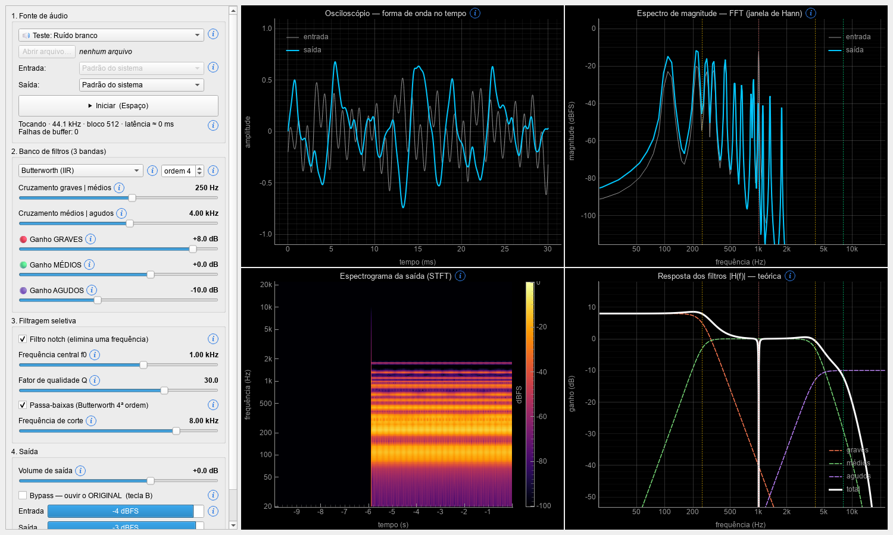
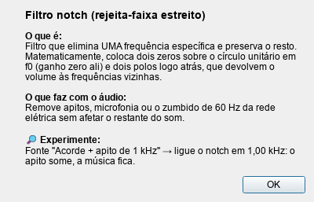

# Equalizador Paramétrico e Filtragem de Áudio em Tempo Real

Projeto da disciplina de **Análise e Processamento de Sinais**: uma aplicação
que captura áudio (microfone, arquivo ou sinais de teste), aplica um **banco de
filtros digitais** de 3 bandas, um **filtro notch** e um **passa-baixas**
ajustáveis, reproduz o resultado nos fones/caixas **em tempo real** e mostra ao
mesmo tempo o sinal no **tempo** (osciloscópio) e na **frequência** (FFT,
espectrograma e resposta teórica dos filtros).



## Funcionalidades

| Requisito | Implementação |
|---|---|
| Captura e leitura | Microfone em tempo real (blocos de 512 amostras + **buffer circular**), arquivos **.wav / .mp3 / .flac / .ogg** e 4 sinais de teste sintéticos |
| Banco de filtros digitais | 3 bandas (graves / médios / agudos) com **Butterworth**, **Chebyshev I** (IIR) ou **FIR** (janela de Hamming, reconstrução perfeita), ordem e frequências de cruzamento ajustáveis, ganho de −24 a +12 dB por banda |
| Filtragem seletiva | **Notch** com f0 e Q ajustáveis; **passa-baixas** Butterworth com corte ajustável |
| Visualização dupla | Osciloscópio com *trigger* + espectro **FFT** (janela de Hann) + **espectrograma** + curva **\|H(f)\|** teórica, a ~30 FPS |
| Interface interativa | Sliders (escala logarítmica para frequência), bypass A/B, medidores de pico, escolha de dispositivos de áudio |
| Ícones ⓘ didáticos | Em cada controle e gráfico: passe o mouse para um resumo ou clique para ver "o que é", "o que faz com o áudio" e um "experimente" |



## Como rodar

Requisito: **Python 3.10+** (testado com 3.14 no Windows 11).

**Windows (mais fácil):** dê dois cliques em `instalar.bat` (uma única vez) e
depois em `executar.bat`.

**Manual / outros sistemas:**

```bash
python -m venv .venv
.venv\Scripts\activate          # Linux/macOS: source .venv/bin/activate
pip install -r requirements.txt
python gerar_amostras.py        # opcional: cria .wav de teste em amostras/
python main.py
```

Opções de linha de comando:

```bash
python main.py --dispositivos   # lista as placas de som
python main.py --bloco 256      # menos latência (mais uso de CPU)
python main.py --fs 48000       # taxa de amostragem do microfone
```

**Atalhos:** `Espaço` = tocar/parar · `B` = bypass (ouvir o original).

> ⚠️ No modo **Microfone**, use **fones de ouvido**: com caixas de som o
> microfone capta a própria saída e gera microfonia (efeito Larsen).

## Testes

```bash
python -m pytest
```

Os 13 testes verificam propriedades teóricas: −3 dB no corte do Butterworth,
atenuação acima do corte, profundidade do notch, reconstrução perfeita do
banco FIR, **processamento em blocos idêntico ao processamento do sinal
inteiro**, ganho aplicado na banda certa, buffer circular e calibração da FFT.

## Estrutura do código

```
main.py                     ponto de entrada (linha de comando)
gerar_amostras.py           gera .wav de teste em amostras/
equalizador/
├── filtros.py              PROJETO dos filtros (coeficientes SOS / FIR)
├── processador.py          APLICAÇÃO dos filtros bloco a bloco, com estado
├── buffer_circular.py      ring buffer: thread de áudio → interface
├── audio_io.py             SoundDevice: microfone (duplex) e reprodução
├── analise.py              FFT com janela de Hann, trigger do osciloscópio
├── sinais_teste.py         ruído branco, chirp, acorde + apito, zumbido 60 Hz
└── interface/
    ├── janela.py           janela principal (PySide6 + PyQtGraph)
    ├── ajuda.py            textos e botão dos ícones ⓘ explicativos
    └── widgets.py          slider com rótulo e escala logarítmica
tests/test_dsp.py           testes automáticos
docs/teoria.md              fundamentação teórica (com fórmulas)
docs/roteiro_apresentacao.md  roteiro passo a passo para a apresentação
```

Fluxo de dados:

```
fonte (mic/arquivo) ─► callback de áudio ─► ProcessadorEQ ─► fones/caixas
                                │                 ▲
                                ▼                 │ parâmetros (sliders)
                         buffers circulares       │
                                │                 │
                                ▼                 │
                    interface (QTimer 30 FPS) ────┘
                    osciloscópio · FFT · espectrograma · |H(f)|
```

## Stack

- **NumPy** e **SciPy** (`scipy.signal`, `scipy.fft`) — DSP
- **SoundDevice** (PortAudio) — entrada/saída de áudio em tempo real
- **SoundFile** (libsndfile) — leitura de .wav/.mp3/.flac/.ogg
- **PyQtGraph** + **PySide6** — interface e gráficos em alta taxa de quadros

## Para estudar

- [`docs/teoria.md`](docs/teoria.md) — amostragem, equação de diferenças, FIR × IIR,
  Butterworth × Chebyshev, banco de filtros, notch, FFT, janelamento, espectrograma.
- [`docs/roteiro_apresentacao.md`](docs/roteiro_apresentacao.md) — demonstração
  em sala, passo a passo, com perguntas prováveis.
